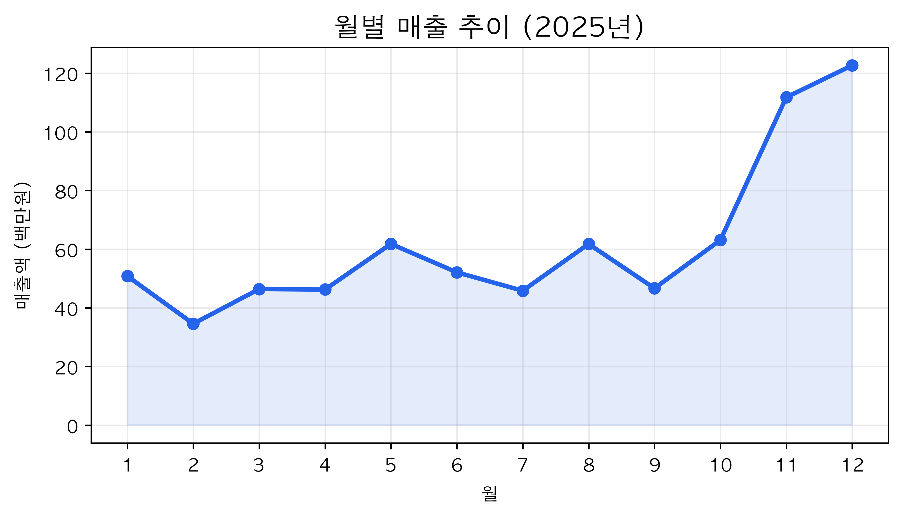
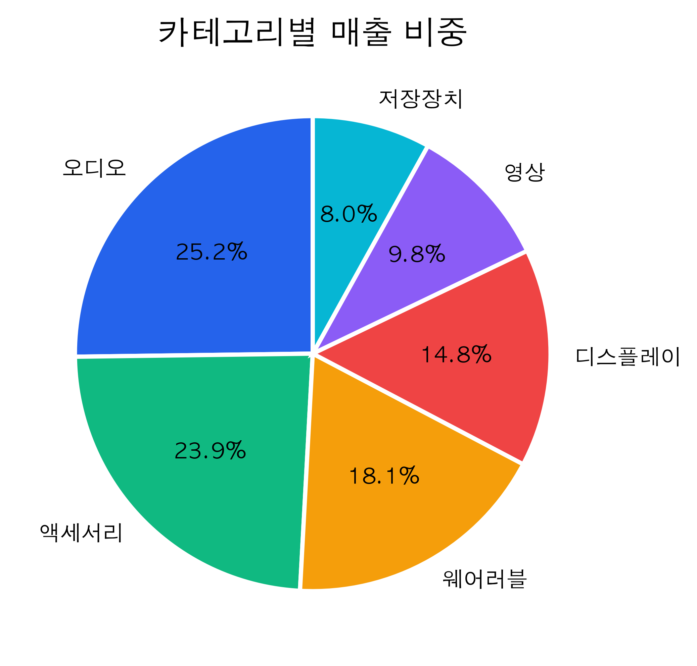
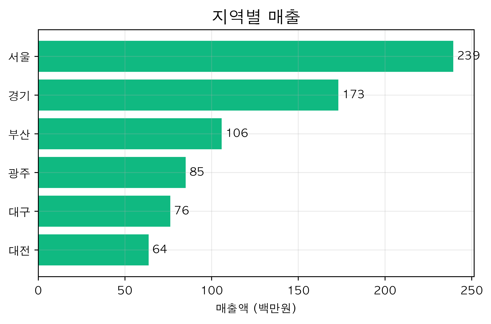
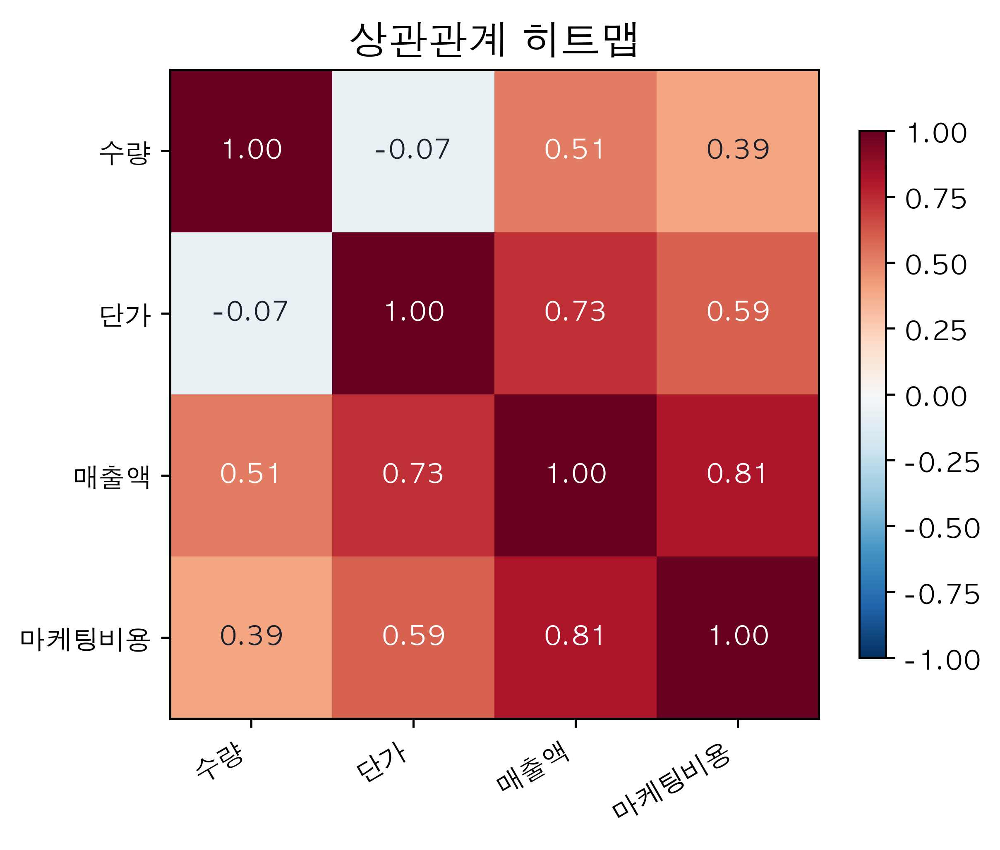
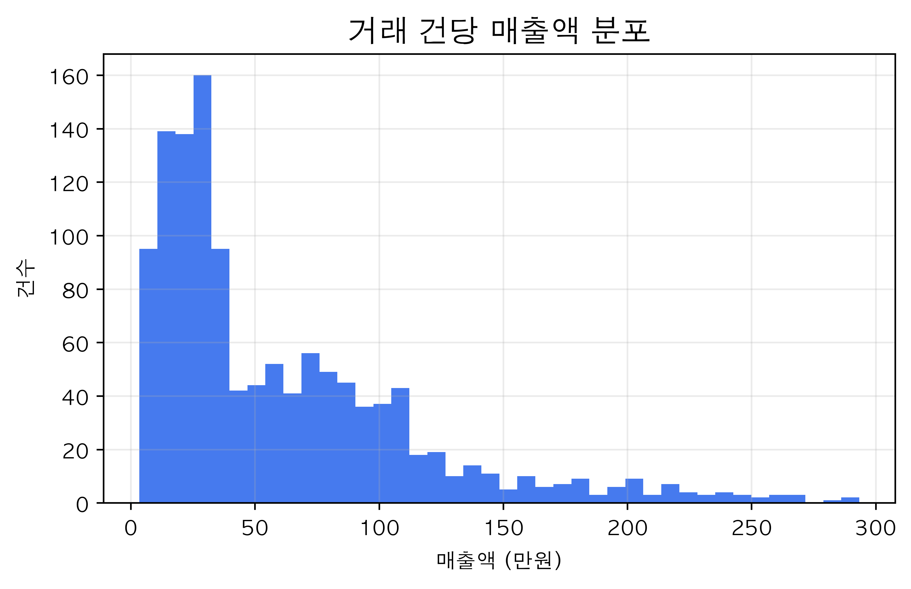

# 월간 매출 분석 리포트

**기간:** 2025년 1월 1일 ~ 2025년 12월 31일  
**생성일:** 2026-08-29  
**데이터:** sales_2025.xlsx (1,234행)

---

## 1. 한 장 요약

2025년 매출은 총 743,457,000원이었습니다. 하반기가 상반기보다 55% 많았고, 12월 한 달에 16%가 몰렸습니다.

## 2. 핵심 지표

| 지표 | 값 |
|---|---:|
| 총 매출 | 743,457,000원 |
| 월 평균 | 61,954,750원 |
| 거래 건수 | 1,234건 |
| 건당 평균 | 602,477원 |
| 최고 매출 월 | 12월 (122,631,000원) |
| 최저 매출 월 | 2월 (34,548,000원) |

## 3. 차트

### 월별 매출 추이

### 카테고리별 매출 비중

### 지역별 매출

### 상관관계 히트맵

### 거래 건당 매출액 분포

## 4. AI 인사이트

AI 인사이트 리포트

핵심 발견

1. 하반기에 매출이 몰린다
   상반기 2.9억 원에서 하반기 4.5억 원으로 55% 늘었습니다. 특히 12월 한 달이 1.23억 원으로 최저인 2월의 3.5배입니다.
   → 연말 수요가 실적을 좌우합니다. 재고와 인력을 10월부터 미리 배치해야 합니다.

2. 마케팅비가 매출을 따라 움직인다
   매출액과 마케팅비용의 상관계수가 0.81입니다. 강한 양의 관계지만 인과는 아닙니다. 많이 팔린 달에 더 썼을 수도 있습니다.
   → 한 카테고리에서 예산만 늘려 보는 소규모 실험으로 인과를 확인하세요.

3. 매출이 소수 거래에 쏠려 있다
   상위 53건, 전체 거래의 4.3%가 매출의 16.1%를 만듭니다.
   → 이 거래들의 공통점(제품·지역·시기)을 따로 보면 재현할 방법이 보입니다.

구성

- 카테고리: 오디오가 25.2%로 1위, 저장장치가 8.0%로 최하위
- 지역: 상위 3개(서울·경기·부산)가 69.7%
- 제품: 스마트워치 X1이 단일 제품 1위 (18.1%)

추천 액션

1. 10~12월 프로모션 예산을 앞당겨 편성합니다.
2. 대전·대구 지역의 부진 원인을 채널별로 나눠 봅니다.
3. 저장장치 카테고리는 유지할지 접을지 다음 분기에 결정합니다.

주의

- 상관관계는 인과관계가 아닙니다.
- 결측치를 중앙값·최빈값으로 채웠습니다. 원본에 빈 칸이 있었다는 사실을 보고서에 함께 적으세요.
- 1년 치 데이터라 계절성을 한 번밖에 관찰하지 못했습니다.

## 5. 부록 — 상세 데이터

| 카테고리 | 매출액 |
|---|---:|
| 오디오 | 187,409,000 |
| 액세서리 | 177,972,000 |
| 웨어러블 | 134,885,000 |
| 디스플레이 | 110,302,000 |
| 영상 | 73,054,000 |
| 저장장치 | 59,835,000 |

| 지역 | 매출액 |
|---|---:|
| 서울 | 239,469,000 |
| 경기 | 173,181,000 |
| 부산 | 105,837,000 |
| 광주 | 85,049,000 |
| 대구 | 76,231,000 |
| 대전 | 63,690,000 |